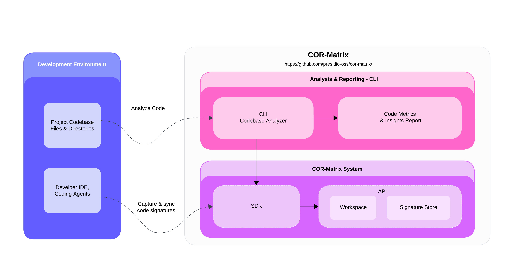

# COR-Matrix

**Code Origin Ratio Matrix** - Track and analyze how much AI-generated code survives in your codebase over time.

<div align="center">
  <picture>
    <source media="(prefers-color-scheme: dark)" srcset="assets/img/cor-matrix.png">
    <source media="(prefers-color-scheme: light)" srcset="assets/img/cor-matrix.png">
    
  </picture>
</div>

## What is COR-Matrix?

COR-Matrix helps development teams understand the real-world impact of AI-generated code by tracking what percentage of originally AI-generated code remains unchanged versus modified or removed during development.

**The Problem:** Teams using AI coding assistants don't know if the generated code is actually useful long-term or gets rewritten immediately.

**The Solution:** COR-Matrix captures signatures of AI-generated code as it's written, then analyzes your codebase later to show retention rates and code evolution patterns.

## Quick Start

### 1. Start the API Server

#### Option A: Using Docker Compose (Recommended)

```bash
# Set up environment variables
cp .env.example .env
# Edit .env file with your actual values

# Start the API server with Docker
docker-compose up -d
```

#### Option B: Local Development

```bash
# Install dependencies
bun install

# Set up environment variables
cp .env.example .env
# Edit .env file with your actual values

# Run database migrations
bun run db:push

# Start the API server
bun run dev:api
```

The API will be available at `http://localhost:3000` with documentation at `http://localhost:3000/docs`.

### 2. Track AI-Generated Code (SDK)

Install the client SDK in your project:

```bash
npm install @presidio-dev/cor-matrix
```

Integrate tracking into your development workflow:

```javascript
import { CorMatrix } from "@presidio-dev/cor-matrix";

const corMatrix = new CorMatrix({
  appName: "my-app",
  baseURL: "http://localhost:3000",
  token: "your-workspace-token",
  workspaceId: "your-workspace-id",
});

// Track AI-generated code as you write it
corMatrix.addCodeOriginRecord({
  code: "console.log('Hello from AI');",
  path: "src/index.ts",
  language: "typescript",
  generatedBy: "copilot",
});
```

### 3. Generate Reports (CLI)

Analyze your codebase to see AI code retention:

```bash
npx @presidio-dev/cor-matrix report \
  --workspace-id your-workspace-id \
  --project-path /path/to/your/project \
  --api-url http://localhost:3000 \
  --api-token your-workspace-token
```

Example output:

```
 COR-Matrix Report
────────────────────────────────────────────────────────────────
Codebase Path:                  /path/to/your/project
Report Time:                    June 1, 2025 at 6:00 PM
Total Lines:                    961 (100%)
AI-Written Lines:               40 of 961 (4.16%)
────────────────────────────────────────────────────────────────
```

## Development

```bash
# Database operations
bun run db:generate    # Generate migrations
bun run db:push        # Apply migrations
bun run db:studio      # Open database GUI

# Development
bun run dev:api        # Start API server with hot reload
bun run build:client   # Build client SDK
bun run build:api      # Build API Docker image
```

## Development Environment Setup

### Runtime Environment

#### Setting up Bun
The project primarily uses Bun as the JavaScript runtime. To set up Bun:

```bash
# Install Bun
curl -fsSL https://bun.sh/install | bash

# Verify installation
bun --version  # Should display 1.2.15 or newer
```

#### Node.js Compatibility
While Bun is the primary development runtime, Node.js is required for some operations:

```bash
# Recommended Node.js version
node --version  # Should be v18 or newer

# Installing dependencies with Bun
bun install
```

### Database Setup

The project uses SQLite with Drizzle ORM for data persistence:

1. **Database Configuration**:
   - Copy `.env.example` to `.env` and configure the database settings
   - By default, the application uses a SQLite file database

2. **Running Migrations**:
   ```bash
   # Apply the latest schema to your database
   bun run db:push
   
   # Generate new migrations when schema changes
   bun run db:generate
   
   # Explore your database with the Drizzle Studio GUI
   bun run db:studio
   ```

3. **Database Structure**:
   - The database schema is defined in TypeScript using Drizzle ORM
   - Migrations are stored in the `drizzle` directory

### Testing

Run integration tests using Vitest:

```bash
# Run all integration tests
bun run test:integration

# Run tests in watch mode during development
bun run test:integration:watch
```

### Docker Development

For containerized development:

```bash
# Build the API Docker image
bun run build:api

# Run with Docker Compose
docker-compose up -d

# View logs
docker-compose logs -f
```

## Architecture

- **API Server**: Elysia.js REST API with SQLite database
- **SDK**: Node.js library for real-time code tracking
- **CLI**: Command-line tool for codebase analysis
- **Database**: Stores code signatures and workspace data

## Tech Stack

### Programming Languages
- **TypeScript**: The entire project is built using TypeScript, providing strong typing, enhanced IDE support, and improved code quality through compile-time error checking.

### Runtime Environments
- **Bun**: A fast all-in-one JavaScript runtime that serves as the primary runtime environment for the project. Bun is used for running the API server, executing scripts, and managing dependencies.
- **Node.js**: Used as a complementary runtime environment, particularly for the SDK which is published as an npm package for broader compatibility with Node.js-based projects.

### Frameworks
- **Elysia.js**: A high-performance TypeScript web framework built on Bun that powers the REST API. Elysia.js offers type-safe route definitions, middleware support, and integrated Swagger documentation.

### Database Technology
- **SQLite**: A lightweight, file-based database engine used for local development and embedded deployments.
- **Drizzle ORM**: A TypeScript-first ORM for SQL databases with a lightweight, relational-focused API. Drizzle handles schema definitions, migrations, and database operations with full type safety.
- **Database Migration**: The project includes automated schema migrations using `drizzle-kit`, with commands for generating and applying migrations (`db:generate`, `db:push`).

### Testing Frameworks
- **Vitest**: A Vite-based test runner with a Jest-compatible API that provides fast, modern testing capabilities. Used for integration testing the API endpoints and core functionality.
- **Testcontainers**: Used in integration tests to create isolated Docker container environments for testing database interactions and API functionality.
- **Supertest**: HTTP assertion library used for testing API endpoints in integration tests.

### Containerization and CI/CD
- **Docker**: The project uses Docker for containerization, with multi-platform support (linux/amd64, linux/arm64). The API server is packaged as a containerized application for easy deployment.
- **Docker Compose**: Provided as the recommended way to run the API server, handling environment configuration and service orchestration.
- **GitHub Actions**: Comprehensive CI/CD pipeline that:
  - Runs integration tests on every push to main and rc branches
  - Builds and publishes Docker images to GitHub Container Registry
  - Builds and publishes the SDK package to npm
  - Handles versioning for both Docker images and npm packages
  - Generates build summaries for each workflow run

## Contributing

We welcome contributions! Please see [CONTRIBUTING.md](CONTRIBUTING.md) for guidelines.

## License

This project is licensed under the MIT License - see the [LICENSE](LICENSE) file for details.

## Security

For security concerns, please see our [Security Policy](SECURITY.md).
